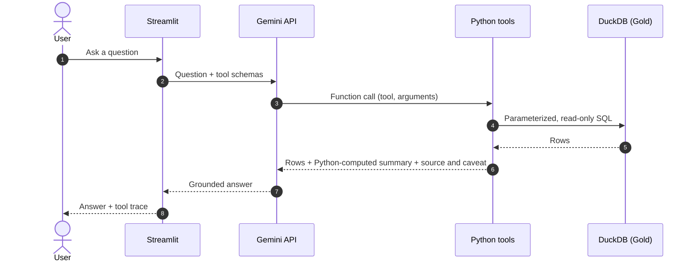

<p align="center">
  
</p>

<p align="center">
  <a href="https://edutanvir.github.io/MineMind/"><b>▶ Animated architecture</b></a> &nbsp;·&nbsp;
  <a href="#how-gemini-is-used">How Gemini is used</a> &nbsp;·&nbsp;
  <a href="#quick-start">Quick start</a> &nbsp;·&nbsp;
  <a href="docs/DEPLOY_DATABRICKS.md">Deploy on Databricks</a> &nbsp;·&nbsp;
  <a href="docs/AI_TOOLING.md">Built with the Gemini tooling</a>
  <!-- TODO after you have the links, uncomment:
  &nbsp;·&nbsp; <a href="PUBLIC_APP_URL"><b>Live app</b></a>
  &nbsp;·&nbsp; <a href="DEMO_VIDEO_URL"><b>Demo video</b></a>
  -->
</p>


<p align="center">

  
  
  
  
  
  
  
</p>


## ⛏️ What is MineMind?

**MineMind turns two public Canadian mining datasets into a Gemini-powered explorer for Northern Ontario.**
Ask a question in plain English; Gemini decides which **verified, read-only query** to run, and every number in the answer comes from the curated data, never from the model's memory.

It was built from scratch for **Hack @ DevFest Sudbury 2026** (MLH Hack Day, hosted by GDG Sudbury) with the Gemini stack, and runs on **Databricks** instead of Firebase and Google Cloud.

| | |
|---|---|
| **Explore** | Interactive map of Ontario mine features from NRCan Map 900A |
| **Analyse** | Monthly metallic-mineral production from Statistics Canada, by commodity and series |
| **Ask** | Natural-language questions answered by Gemini function calling over read-only tools |
| **Trust** | Sources, licences and caveats travel with every result; a tool trace shows how each answer was made |


## 🧭 Architecture

<p align="center">
  <a href="docs/assets/architecture.svg">
    
  </a>
</p>

<p align="center"><sub>The diagram is animated in a browser: the green dot walks the flow step by step. Click it to open full size, or use the <a href="https://edutanvir.github.io/MineMind/">full-screen animated version</a>. A static copy is in <a href="docs/assets/architecture.png"><code>docs/assets/architecture.png</code></a>.</sub></p>


## 🤖 How Gemini is used

Gemini is the reasoning core, not a wrapper around a chat box. It receives the user's question plus the schemas of three Python tools, **chooses which tool to call and with what arguments**, reads the structured result, and writes the answer.



### The only three things Gemini can do

| Tool | Data | What it returns |
|---|---|---|
| `get_production_trend` | Statistics Canada Table 16-10-0019-01 | Monthly series by geography, commodity and measure, plus per-series summaries |
| `search_mines` | NRCan Map 900A | Mapped features by province, commodity or name |
| `mines_near_place` | NRCan Map 900A | Features within a radius of Sudbury or Timmins, nearest first |

### Guardrails built into the tools (`src/ai/tools.py`)

- **Read-only by construction.** DuckDB is opened with `read_only=True`; there is no tool that writes.
- **Parameterized SQL.** User-supplied values are bound as parameters; the one column name that is interpolated is checked against a fixed allowlist.
- **Bounded results.** Row limits, month windows and radius are clamped (for example 50 rows, 1 to 240 months, 1 to 300 km).
- **The model never does arithmetic.** Totals, averages, latest values and tonne conversions are computed in Python and returned as ready-made fields.
- **No invented numbers from missing data.** Suppressed (`x`) and unavailable (`..`) months are counted as missing, never as zero.
- **No mixing of series.** Concentrates, recoverable and refined figures are separate series and are never added together.
- **Self-correcting errors.** A bad argument returns the list of valid values, so Gemini can retry instead of guessing.
- **Provenance on every result.** Dataset name, licence and caveat are attached to what the model sees.


## 🧱 Data pipeline (Bronze → Silver → Gold)

| Layer | What it holds | Where |
|---|---|---|
| **Bronze** | Original downloads, untouched: NRCan `900A.gdb` and Statistics Canada CSV | `data/raw/` |
| **Silver** | Cleaned, standardized and validated tables | `data/processed/silver/` (`silver_mines`, `silver_statcan_production`) |
| **Gold** | Curated analytical tables: `dim_mine_feature`, `fact_mineral_production_monthly`, `etl_run_log`, `source_manifest` | `data/processed/gold/` |
| **Serving** | DuckDB database over the Gold layer, queried by the app and the Gemini tools | `data/minemind.duckdb` |

Code: [`src/ingestion/`](src/ingestion) (download and validation), [`src/transformation/`](src/transformation) (cleaning), [`src/pipeline.py`](src/pipeline.py) (orchestration), [`scripts/build_db.py`](scripts/build_db.py) (DuckDB build). Each run is recorded in `etl_run_log`, and `source_manifest` keeps source metadata.

### Data sources and honest limits

| Source | Licence | Caveat |
|---|---|---|
| [NRCan Map 900A](https://natural-resources.canada.ca) (Principal Mineral Areas, Producing Mines, and Oil and Gas Fields) | Open Government Licence – Canada | Significant mapped features only; not a complete list of mines |
| [Statistics Canada Table 16-10-0019-01](https://www150.statcan.gc.ca/t1/tbl1/en/tv.action?pid=1610001901) (monthly mineral production) | Statistics Canada Open Licence | Provincial totals, not mine-level; recent months can be revised; `..` means not available and `x` means suppressed |

The two datasets are complementary and are **not linked at individual-mine level**. MineMind says so rather than guessing.


## 🚀 Quick start

```bash
git clone https://github.com/edutanvir/MineMind.git
cd MineMind

python -m venv .venv && source .venv/bin/activate     # Windows: .venv\Scripts\activate
pip install -r requirements.txt

cp .env.example .env                                   # then add your GEMINI_API_KEY

# Skip these two if data/minemind.duckdb already exists
python -m src.pipeline                                 # Bronze -> Silver -> Gold
python scripts/build_db.py                             # load Gold into DuckDB

streamlit run app.py
```

Get a free Gemini API key from [Google AI Studio](https://aistudio.google.com/apikey). The model is set with `GEMINI_MODEL` in `.env`.

**Run the tests** (no API key needed for the tool tests):

```bash
pytest -q
```


## ☁️ Deploy on Databricks

GitHub → **Databricks Apps** (hosts the Streamlit app) with the Gemini key held in a **Databricks Secret Scope**, exposed to the app as an environment variable through `valueFrom` in `app.yaml`. The key never appears in the code or the repo.

Step-by-step: [`docs/DEPLOY_DATABRICKS.md`](docs/DEPLOY_DATABRICKS.md).

> **Note for reviewers:** Databricks Apps are only reachable by signed-in Databricks users, so a public link is not possible from Databricks itself. Use the demo video, run MineMind locally with the Quick start above, or open the public mirror linked at the top of this page when available.


## 🛠️ Built with the Gemini tooling

| Tool | Role in this project |
|---|---|
| **Gemini API (free tier)** | Core reasoning and function calling: chooses tools, reads results, writes grounded answers |
| **Gemini CLI + agents + skills** | Project context in [`GEMINI.md`](GEMINI.md) and reusable skills in [`.agents/skills/`](.agents/skills) (data-quality check, add a new AI tool) |
| **Google Antigravity** | Agent-first IDE used early in the build, until the free credit ran out; workspace rules in [`.agents/rules/`](.agents/rules) |
| **Databricks** | Hosting (Apps) and secrets (Secret Scope), used instead of Firebase and Google Cloud |

Details and how to reproduce: [`docs/AI_TOOLING.md`](docs/AI_TOOLING.md).

## ✅ Evaluating the AI

- **Tool contract tests** ([`tests/test_tool_guards.py`](tests/test_tool_guards.py)) check the guardrails offline: read-only connection, injection strings stay inert, limits are clamped, missing data is never treated as zero.
- **Golden questions** ([`evals/golden_questions.json`](evals/golden_questions.json)) run through Gemini with [`scripts/run_eval.py`](scripts/run_eval.py), covering tool choice, arguments, honest caveats and refusals. Run it to regenerate `evals/results/latest.md`.

<details>
<summary><b>📁 Project structure</b></summary>

```text
MineMind/
├── app.py                      Streamlit entry point (Overview)
├── app.yaml                    Databricks Apps configuration
├── pages/
│   ├── 1_Ontario_Mine_Explorer.py
│   ├── 2_Production_Analytics.py
│   ├── 3_Ask_MineMind.py       Gemini-powered Q&A
│   └── 4_Data_and_Methods.py
├── src/
│   ├── ingestion/              load_nrcan.py, load_statcan.py
│   ├── transformation/         clean_data.py
│   ├── pipeline.py             Bronze -> Silver -> Gold
│   ├── database/               duckdb_manager.py
│   ├── analytics/              mine_queries.py
│   ├── ai/                     gemini_agent.py, tools.py, guard.py
│   └── ui/                     theme.py, trace_panel.py
├── data/
│   ├── raw/                    Bronze (original downloads)
│   ├── processed/              silver/ and gold/ Parquet
│   └── minemind.duckdb         serving database
├── tests/                      pytest suite
├── evals/                      golden questions and results
├── scripts/                    build_db.py, run_eval.py
├── docs/                       architecture, deployment, AI tooling, demo script
├── GEMINI.md                   context for Gemini CLI
└── .agents/                    rules and skills (Gemini CLI + Antigravity)
```

</details>


## 🗺️ Limits and next steps

- Production data is provincial; linking it to individual mines needs a source that reports at mine level.
- Map 900A lists significant mapped features, not every mine.
- `mines_near_place` currently knows Sudbury and Timmins.
- Next: more place anchors, a data-freshness indicator on the Data and Methods page, and a larger golden-question set.

## 👤 Author

**Md Tanvir Ahmed**, Azure Data Engineer · [LinkedIn](https://www.linkedin.com/in/tanvir-de) · [GitHub](https://github.com/edutanvir)

## 📄 Licence


---

## Copyright, Ownership & Strict Proprietary License

**Copyright © 2026 Md Tanvir Ahmed. All Rights Reserved.**

MineMind is proprietary software and an independently developed project. All rights, title, and interest in the original source code, application architecture, implementation, documentation, designs, and other original project materials are expressly reserved by the copyright owner, except for third-party materials governed by their respective licenses.

**NO PERMISSION IS GRANTED TO:**

- Copy, reproduce, duplicate, or redistribute any portion of this repository.
- Fork, clone, mirror, or republish this project or its source code.
- Modify, adapt, translate, reverse engineer, or create derivative works.
- Use this project, its source code, or its components for personal, educational, academic, research, or commercial purposes without prior written authorization.
- Rebrand, present, distribute, or claim any part of this project as your own.
- Deploy, host, sublicense, sell, or commercially exploit this software or its implementation.
- Extract, reuse, or incorporate proprietary project materials into another application, product, or repository.

**Unauthorized access, copying, reproduction, distribution, modification, or other use of protected materials is strictly prohibited.**

Any individual or organization seeking permission to use, reproduce, modify, distribute, or otherwise utilize MineMind must obtain explicit prior written authorization from the copyright owner.

Unauthorized use may result in appropriate legal action and claims for available remedies under applicable copyright and intellectual property laws.

Viewing this public repository does not grant any license, ownership interest, permission, or other rights to use its proprietary materials.

**This repository is published for demonstration and portfolio evaluation purposes only. Public visibility does not constitute permission to copy, reuse, distribute, or commercially exploit the project.**

For licensing inquiries or written authorization, contact the copyright owner.

See the [LICENSE](LICENSE) file for the full licensing terms.


Data: NRCan Map 900A under the [Open Government Licence – Canada](https://open.canada.ca/en/open-government-licence-canada); Statistics Canada Table 16-10-0019-01 under the [Statistics Canada Open Licence](https://www.statcan.gc.ca/en/terms-conditions/open-licence).

<p align="center"><sub>Built for Hack @ DevFest Sudbury 2026 · Gemini + Databricks</sub></p>
